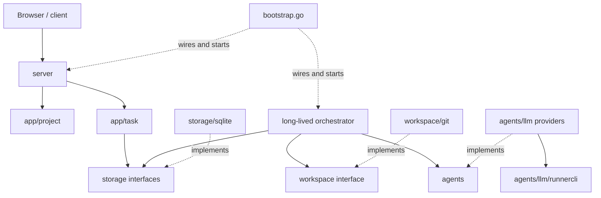

# AI Factory Architecture

This document records the agreed package boundaries for the AI Factory server and its task execution system. Keep it current as the implementation evolves; agents should read it before changing package layout or adding cross-package dependencies.

The current implementation provides project registration, the local HTTP server, SQLite persistence, and Git project/worktree operations. The task lifecycle and its long-lived orchestrator are architectural targets for the task-execution phase; do not add a placeholder worker before its task states and execution contract are defined.

## Product entry point

The HTTP server is the primary application entry point. The browser UI and other clients use the server API. The `aifactory serve` CLI command starts the server; the other CLI commands remain focused on setup and rule operations.

The server handles requests and delegates to project and task capabilities. It does not own project rules, persistence, Git operations, or task execution logic.

## Package responsibilities

```text
internal/
  server/          HTTP API, routing, middleware, and UI delivery
    dialog/        native project folder selection
    instance/      process lock for the local server
  app/             application use cases
    project/       project registration and project-level use cases
    task/          task data and task-level use cases
  agents/          agent contracts and agent behavior
    llm/           shared provider runner options
      codex/       Codex CLI implementation
      claude/      Claude Code CLI implementation
      runnercli/   shared CLI process, sandbox, and session handling
  sandbox/         OS-level filesystem permissions for child processes
  storage/         database lifecycle contract
    sqlite/        SQLite implementations and migrations
  workspace/       task-workspace interface and shared workspace types
    git/           Git repository, branch, and worktree operations
  model/           data types shared across package boundaries
  config/          application configuration
web/               Vue source, Vite build output, and Go asset embedding
```

### Server

`server` is the inbound HTTP adapter and the primary product entry point. Handlers validate transport input, call project/task use cases, and translate results into HTTP responses. Keep business rules and orchestration out of handlers.

Bootstrap wires the native folder picker from `server/dialog` and acquires the `server/instance` lock before starting the local HTTP server.

### Projects and tasks

`project` owns project registration and project-level behavior. A project is the registered source repository and stores a default base branch for new tasks. The default is detected when registering a Git repository and can be changed in project settings.

`task` owns task data and task-level behavior. A task snapshots the project's default base branch when created, and the user may choose a different branch in the task form. Store that selected branch on the task: its worktree starts from that branch's contents, and its eventual PR targets that same branch even if the project default changes later. Creating a task records it and makes it available for execution; task creation does not construct or start an orchestrator.

When detecting the project default, prefer `origin/HEAD`, then a local or remote `main`/`master`, and then the checked-out branch. Keep the result editable per project. Task creation may override it with any existing branch that has a commit.

### Orchestrator

The planned `internal/app/orchestrator` is a long-lived service started once as part of server startup. It consumes pending task work, coordinates the required agents, and updates task state through storage interfaces. It requests a task workspace when execution begins. The persistence and wake-up mechanism must support recovery after a server restart.

### Agents and LLM providers

`internal/agents` groups agent behavior with its provider integrations. The `agents` package owns the `Agent` and `AgentRunner` contracts. The Codex and Claude packages under `agents/llm` implement `AgentRunner` and share `agents/llm/runnercli` for process lifecycle, filesystem sandbox setup, and session directories.

Bootstrap selects a provider and injects it through `AgentRunner`. The orchestrator coordinates agents through their contracts. Provider packages import the contract from `agents` and use `runnercli` to launch their CLI processes.

Treat cancellation as a design principle. The caller owns the context for a turn and passes it through the agent to `AgentRunner.Run`. The shared CLI runner terminates the provider's process group on cancellation and returns the context error. Simulated provider CLIs exercise this behavior without live credentials.

### Storage

`storage` declares the database lifecycle contract. Projects and tasks own their repository interfaces, and `storage/sqlite` implements them and owns SQLite migrations. Shared `model` types carry data across these boundaries.

Feature and orchestration code uses the repository interfaces. Bootstrap opens the concrete SQLite adapter and injects the repositories.

### Task workspaces

`workspace` defines the interface for an isolated task working directory. `workspace/git` implements it with Git worktrees, using the task's saved base branch rather than the repository's currently checked-out branch. The orchestrator uses this interface and passes the resulting working directory to agents.

Project registration consumes the repository operations in `workspace.SourceControl`. The broader `workspace.Repository` contract also exposes branch merge and push. Task worktree creation and removal use `workspace.Manager`. All three contracts are declared in `internal/workspace`, with command construction and execution private to `internal/workspace/git`.

### Bootstrap and lifecycle

Root-level `bootstrap.go` constructs the concrete storage and Git implementations, injects them into project and task services, and manages the local HTTP server lifecycle. The CLI receives the server startup function from bootstrap. When the orchestrator is implemented, bootstrap will start and stop it with the server under the same application context.

## Dependency direction



Concrete implementations depend on their interface packages. Application features depend on interfaces and shared model types. Root-level `bootstrap.go` is the composition root that imports both sides and connects them.
